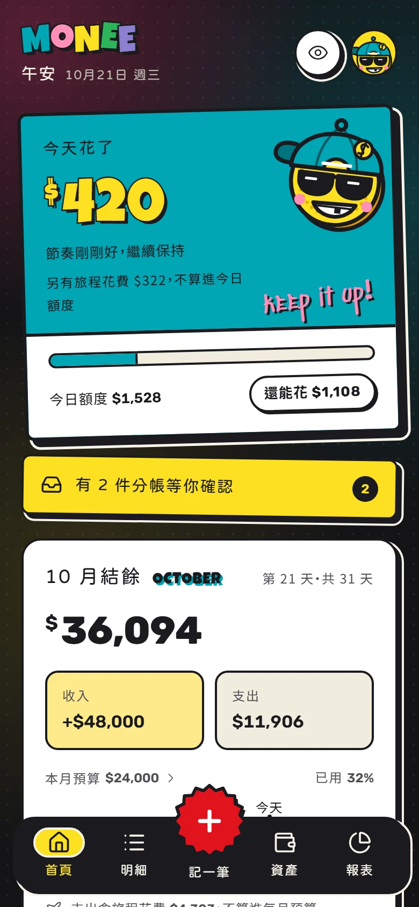
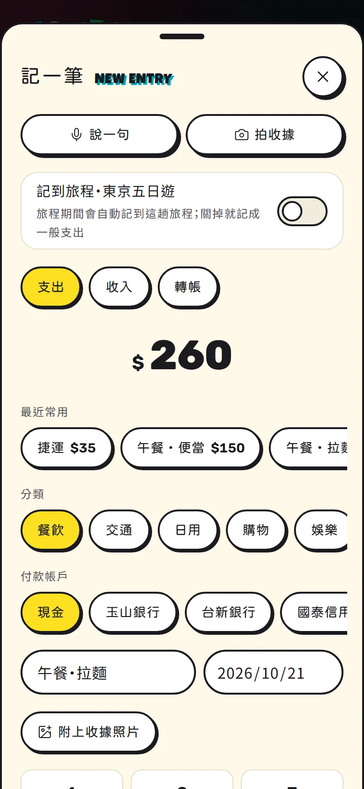
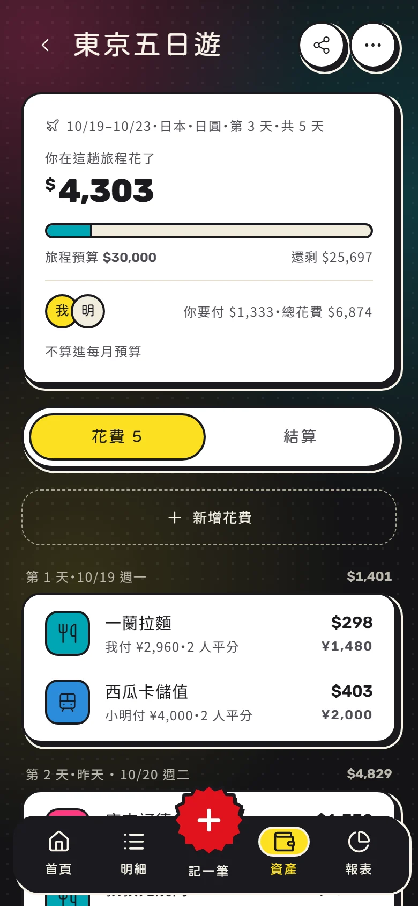
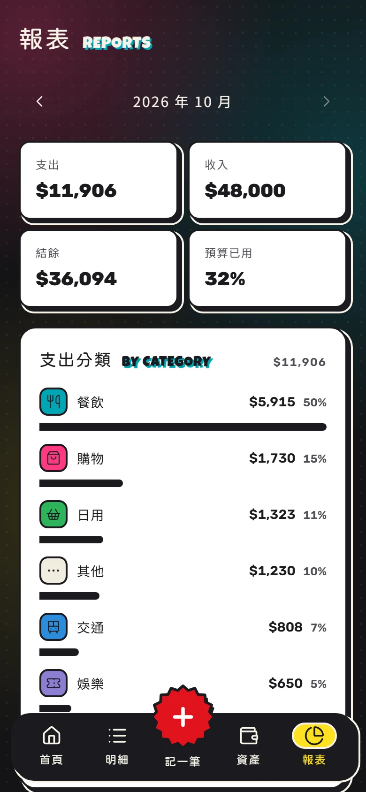
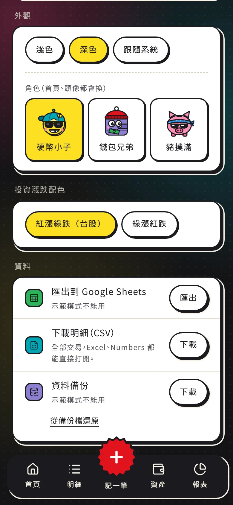
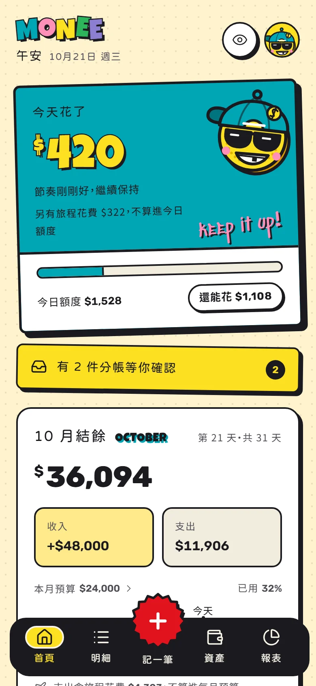

# Monee

> 可愛輕量、懂你金流的個人生活財務助理。*Know your money. Grow your money.*

Monee 是給自己用的手機記帳網頁：說一句話或拍張收據就能記帳，跟朋友分帳、出國旅行記外幣，月底看報表，資料隨時可以匯出或備份。可以加到手機主畫面，用起來像 App。

## 畫面

<table>
  <tr>
    <td align="center" width="33%"><br>首頁：今天還能花多少</td>
    <td align="center" width="33%"><br>記一筆：說一句、拍收據、手動</td>
    <td align="center" width="33%"><br>旅程：外幣花費與旅程預算</td>
  </tr>
  <tr>
    <td align="center" width="33%"><br>報表：分類支出、每月趨勢</td>
    <td align="center" width="33%"><br>三個角色任選、深淺色</td>
    <td align="center" width="33%"><br>淺色模式</td>
  </tr>
</table>

> 截圖來自示範模式（`npm run dev:demo`），預設深色；角色、深淺色在「我的 → 外觀」切換。

## 功能

- **記帳**：手動輸入、說一句（「午餐拉麵 260 刷國泰」）、拍收據；AI（Gemini）只整理成草稿，確認後才記下。收據照片會留著，之後點那筆就看得到。
- **今日額度**：照每月預算算出今天還能花多少，超支時用鼓勵的語氣提醒。
- **帳戶與資產**：現金、銀行、信用卡、投資帳戶，校準餘額時自動補差額；淨資產一眼看清楚。
- **分帳**：誰先付都能記，自動算出最少的轉帳；朋友不用註冊，點分享連結就能看帳、說已付款、新增花費。
- **旅程**：有日期、外幣與匯率、旅程預算，可以設定不算進每月預算。
- **報表**：每月收支、各分類支出、預算比較。
- **分類管理**：新增自己的分類、改名換圖示、隱藏、排序。
- **固定收支**：房租、訂閱、薪水每月／每週／每年一次，到了日子自動記下，或在首頁問你要不要記。
- **連續記帳**：首頁看連續幾天、這一週的記帳章，沒花錢的日子蓋無消費章；月曆頁看每個月，連續 7、30、100、365 天拿徽章。
- **資料**：匯出到 Google Sheets、下載明細 CSV、下載備份檔並整個還原。
- **其他**：街頭貼紙風的介面（預設深色，也有淺色）、三個角色任選、金額可以一鍵隱藏。

## 快速試用

不用任何帳號或設定，用記憶體裡的範例資料：

```bash
cd web
npm install
npm run dev:demo
```

打開 <http://localhost:3000>。要接上自己的資料庫（Supabase）、AI 記帳、Google Sheets 匯出，照 [`web/README.md`](web/README.md) 的步驟設定。

## 技術

Next.js 16（App Router）・React 19・TypeScript・Tailwind CSS 4・Supabase（登入、Postgres、Storage，每張表都開 RLS）・TanStack Query・Zustand・Gemini API・Vitest

## 專案結構

```
web/                    Monee 網頁（程式、資料庫 migration、測試）
  README.md             設定步驟、指令、設計與實作決定
design-system/monee/    設計系統：MASTER.md（規則）、tokens.css（顏色字級等數值）、styleguide.html（樣式總覽）
monee_ux.md             產品與 UX 規格、路線圖
prototype/              互動原型（首頁、分帳）
monee-home*.html        首頁設計稿（monee-home-pop.html 是現在的街頭貼紙版）
monee-mascot.html       三個角色的設計稿
docs/screenshots/       README 的畫面截圖
```

## 文件

| 想知道 | 看這裡 |
|---|---|
| 怎麼設定、部署、每個功能怎麼做的 | [`web/README.md`](web/README.md) |
| 產品規格與路線圖 | [`monee_ux.md`](monee_ux.md) |
| 顏色、字體、元件規則 | [`design-system/monee/MASTER.md`](design-system/monee/MASTER.md) |

## 路線圖

- **Phase 1（完成）**：手動記帳、帳戶與校準、首頁、明細、資產、報表。
- **Phase 2（完成）**：AI 記帳、分帳與旅程、Google Sheets 匯出、CSV、資料備份、收據照片、分類管理、固定收支、連續記帳。
- **Phase 3**：Monee Invest（另一個專案）同步投資快照。
